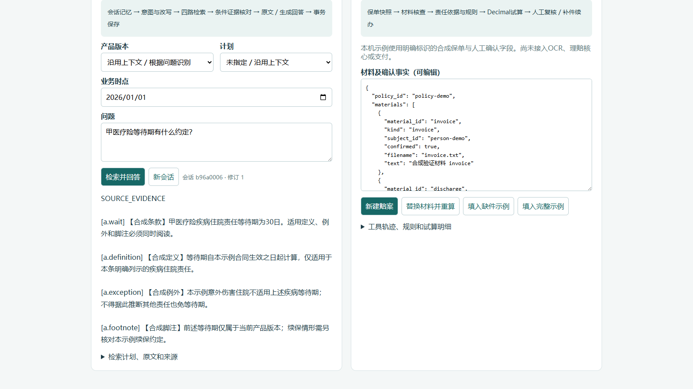

# ClaimMate / ClaimFlow

**Insurance policy evidence and claims preparation, with traceable sources and explicit gaps.**

ClaimMate combines version-scoped source retrieval, conversational references, material checks, deterministic rules, and Decimal calculations in one workbench. It prepares evidence and review reports for a human operator.

The standalone build uses **synthetic products and policy records** and runs **without an external LLM or API key**. The web interface and example questions are in Chinese; the demonstration video has English narration and English/Chinese subtitle files.



## What you can try

- Ask about a waiting period and inspect its original clause, definition, exception, and footnote.
- List two other products, then ask about the second result using committed conversation order.
- Trigger clarification when a product reference is ambiguous.
- Submit incomplete example claim materials and inspect the missing-document list.
- Supplement those materials, evaluate registered rules, and inspect a Decimal estimate and execution trace.
- See material revisions, idempotent requests, source integrity checks, and human-review labels.

## Quick start

Use Python 3.11 in a fresh virtual environment. From the repository root:

```sh
python -m venv .venv
```

Activate it with `.venv\Scripts\Activate.ps1` on Windows PowerShell, or `source .venv/bin/activate` on macOS/Linux. Then run:

```sh
python -m pip install -r requirements-demo-dev.txt
python -B -m pytest -q tests/enterprise/test_workflows.py
python -B -m rag_assist.enterprise check --mode synthetic --state runtime/demo/state.sqlite
python -B -m rag_assist.enterprise serve --mode synthetic --model none --port 8878 --state runtime/demo/state.sqlite
```

Open **http://127.0.0.1:8878**. The local launcher creates a token in `runtime/enterprise/access-token.txt` when `CLAIMMATE_ACCESS_TOKEN` is not set. Paste that local value into the workbench's access field, then connect. Do not commit the token.

Use the `requirements-demo*.txt` files for this standalone path. `requirements-demo-lock.txt` records the complete resolved verification environment and can be installed directly for the closest reproduction. `requirements-demo-lock.txt` records the complete resolved verification environment and can be installed directly for the closest reproduction. `requirements-demo-lock.txt` records the complete resolved verification environment and can be installed directly for the closest reproduction. The other requirement files are copied declarations for the broader source project, and are not the dependency set used for this demo's verification.

## Suggested journey

1. Ask `甲医疗险等待期有什么约定？`.
2. Ask `再列出两个其他产品的等待期条款`, followed by `第二个有哪些例外？`.
3. Start a new conversation, repeat the initial question and two-other-products question, then ask `那它呢？` to see clarification.
4. In the claims panel, choose **填入缺件示例**, then **新建赔案**.
5. Choose **填入完整示例**, then **替换材料并重算**.
6. The synthetic example should reach `AWAITING_HUMAN_REVIEW`, with an estimate of **640.01**. This is an example calculation, not a formal insurance decision.

See [reviewer testing instructions](docs/testing.md).

## Architecture

```text
Browser workbench -> FastAPI authorization and request validation
                  -> LangGraph conversation / claims workflow
                  -> source and dependency checks / material and rule checks
                  -> atomic SQLite state + idempotency
                  -> evidence or report for human review
```

The source also contains optional adapters for public-corpus retrieval and external models. Their data, infrastructure services, model weights, credentials, and original business documents are not included. The synthetic route outputs do not establish a running OpenSearch/Neo4j/BGE deployment.

## Deployment recipe

A separate container entry point is included for hosting the same synthetic application:

```sh
docker build -t claimmate-demo .
docker run --rm -p 8000:8000 -e CLAIMMATE_ACCESS_TOKEN -v claimmate-demo-state:/app/runtime/demo claimmate-demo
```

Set a nonempty `CLAIMMATE_ACCESS_TOKEN` in the launching environment before running the container. `demo_app.py` requires it; it does not contain a default credential. Open port 8000 through the host's normal HTTPS routing and provide the reviewer token privately.

The prototype uses a shared demonstration workspace. Use synthetic data only. A live public URL must be tested after the owner selects a host; no public deployment is claimed by this source package. The container was built and passed seven HTTP checks on Linux/amd64. A prebuilt test-build archive is prepared for GitHub Releases; see [deployment instructions](docs/deployment.md).

## Kiro configuration

The root [`.kiro`](.kiro/README.md) directory contains project steering and a demo requirements/design/tasks spec. It is intentionally tracked. These documents are a starting point for actual Kiro work; their presence alone is not a record of Kiro development. See the spec task status and any real session records for work actually completed in Kiro.

## Scope and license

This is a local functional prototype, not a production underwriting or claims system. Evidence-only fallback is intentionally different from an LLM-generated answer. Real policy applicability, expert accuracy, training results, and insurer deployment are not established by this demonstration.

The source is provided under the [MIT License](LICENSE). Dependencies retain their own licenses. Synthetic text is bundled in `demo.py`; no insurer PDFs, original runtime, private documents, or model weights are redistributed here.
